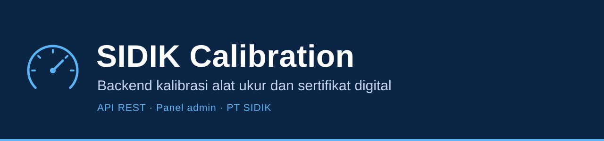
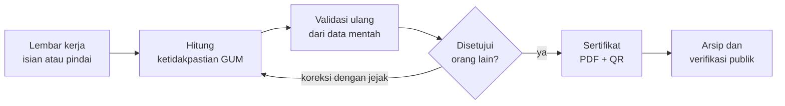
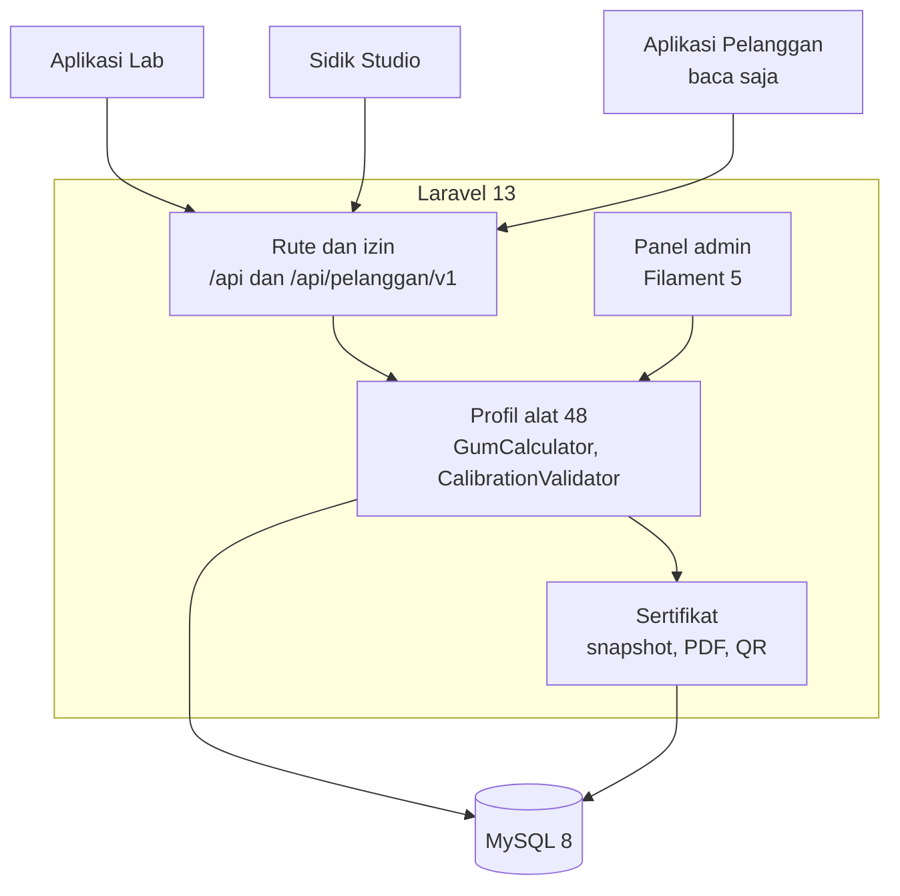

<p align="center">
  
</p>

<p align="center">
  <a href="https://github.com/ZainulArkaanAlinsi/sidik-calibration-api/actions/workflows/tes.yml"></a>
  
  
  
  
  
</p>

> **English.** SIDIK Calibration API is the backend of the calibration laboratory system of PT SIDIK, built with Laravel 13 and Filament 5. It computes calibration results from worksheet readings using GUM-based uncertainty budgets (JCGM 100:2008), requires an independent approver, and issues digitally verifiable certificates (PDF with QR code). It serves the Lab app, Sidik Studio and a read-only customer app. It is a support system for a KAN-accredited laboratory (LK-285-IDN) and is under active development.

**Isi:** [Ringkasan](#ringkasan) · [Peran dan fitur](#peran-dan-fitur) · [Cara kerja](#cara-kerja) · [Arsitektur](#arsitektur) · [Prinsip integritas](#prinsip-integritas) · [Teknologi](#teknologi) · [Menjalankan secara lokal](#menjalankan-secara-lokal) · [Pengujian](#pengujian) · [Dokumentasi](#dokumentasi) · [Status dan peta jalan](#status-dan-peta-jalan) · [Kontribusi dan kepemilikan](#kontribusi-dan-kepemilikan)

## Ringkasan

SIDIK Calibration API adalah backend kalibrasi alat ukur dan penerbitan sertifikat digital untuk laboratorium kalibrasi PT SIDIK. Alurnya dipindahkan dari lembar kerja kertas dan Excel ke satu jalur terkendali: teknisi mengisi lembar kerja di aplikasi, server menghitung ketidakpastian menurut JCGM 100:2008 (GUM), lembar disetujui orang lain, lalu sertifikat PDF dengan kode QR terbit dan dapat diverifikasi publik. Angka diadu ke workbook master lab dan ke lampiran akreditasi.

Repo ini melayani tiga klien: aplikasi Lab dan Sidik Studio ([`sidik-calibration-mobile`](https://github.com/ZainulArkaanAlinsi/sidik-calibration-mobile)), aplikasi Pelanggan ([`sidik-pelanggan-mobile`](https://github.com/ZainulArkaanAlinsi/sidik-pelanggan-mobile)), dan panel admin Filament di `/admin`. Sistem pendukung laboratorium terakreditasi KAN LK-285-IDN.

## Peran dan fitur

Kunci peran di kode dan basis data tetap; "Master Data" adalah nama tampilan peran `admin`.

| Peran | Kunci | Wewenang utama |
| --- | --- | --- |
| Teknisi | `teknisi` | Mengisi lembar kerja (isian atau hasil pindai), pratinjau hitung, mengirim untuk persetujuan. Tidak mengisi Order Number dan tidak menyetujui lembar yang ia isi sendiri. |
| Master Data | `admin` | Mengelola data master (alat, pelanggan, standar, ruangan, metode), mengisi Order Number, mengoreksi pembacaan dengan alasan, menyetujui dan menerbitkan sertifikat, menarik sertifikat, mengundang anggota pelanggan. Memakai panel Filament. |
| Super Admin | `super_admin` | Semua aksi teknisi dan Master Data di organisasinya, lewat aplikasi; di panel admin hanya baca. Mengaktifkan versi data acuan (orang kedua, bukan pembuat versi). |
| Viewer | `viewer` | Baca saja. Tidak ditawarkan untuk akun baru; akun lama tetap berlaku. |
| Pelanggan | `pelanggan` | Aplikasi terpisah, baca saja, per perusahaan, lewat `/api/pelanggan/v1`. Akun lahir dari undangan; tidak ada pendaftaran mandiri. |

| Area | Yang tersedia |
| --- | --- |
| Hitung dan validasi | 48 profil alat terdaftar. Budget ketidakpastian GUM, keputusan lulus/gagal dengan *guarded acceptance* (ILAC-G8: `\|error\| + U` masuk toleransi), hitung ulang dari data mentah sebelum terbit. |
| Persetujuan | Koreksi dengan jejak (nilai lama, nilai baru, alasan), perbandingan nilai asli dan koreksi, pemisahan wewenang. |
| Sertifikat | PDF dari snapshot yang dibekukan, kode QR, halaman verifikasi publik, revisi dan penarikan dengan jejak. |
| Pindai lembar kerja | Foto menjadi usulan angka yang wajib dikonfirmasi manusia. Mode uji. |
| Data acuan dan rumus | Parameter acuan berversi (ajukan, simulasi, aktifkan). Tiap hasil hitung menyimpan versi rumus dan acuan yang dipakai. |
| Arsip dan pelacakan | Arsip sertifikat per perusahaan, pelacakan paket, penugasan, jatuh tempo dan pengingat. |
| Modul pelanggan | API baca saja untuk alat, sertifikat, paket, dan notifikasi. |
| Realtime dan laporan | Laravel Reverb (websocket), notifikasi push, laporan kalibrasi dan ekspor Excel. |

## Cara kerja



1. **Isi.** Nilai teknisi disimpan apa adanya. Hasil pindai hanya usulan dan harus dikonfirmasi manusia.
2. **Hitung.** Server yang menghitung, termasuk pratinjau, supaya angka di layar tidak berbeda dari yang tercetak. Nilai antara tidak dibulatkan.
3. **Validasi.** `CalibrationValidator` menghitung ulang dari data mentah dan mengadu ke hasil tersimpan (error, peringatan, info).
4. **Setujui.** Penyetuju bukan pengisi lembar atau pengonfirmasi hasil pindai. Nomor sertifikat dan Order Number wajib.
5. **Terbit.** Snapshot dibekukan, PDF dan QR dibuat. Hasil tersimpan tidak dihitung ulang saat dibaca.
6. **Arsip dan verifikasi.** Sertifikat masuk arsip perusahaan; QR menuju halaman verifikasi publik.

## Arsitektur



| Lapisan | Tempat | Catatan |
| --- | --- | --- |
| Rute | `routes/api.php`, `routes/api_pelanggan.php` | Rute pelanggan terpisah penuh; izin dari middleware `role:` |
| Profil alat | `app/Services/Calibration/Profiles/` | Satu jenis alat satu profil, didaftarkan di `CalibrationProfileRegistry` |
| Hitung | `GumCalculator`, `CalibrationValidator`, `App\Support\*Mentah` | Jalur kedua: `php artisan kalibrasi:hitung-ulang` |
| Sertifikat | `CertificateSnapshotBuilder`, `BerkasPdfSertifikat`, `QrCodeGenerator` | Dari snapshot beku |
| Panel admin | `app/Filament/` | Disaring per organisasi |
| Data | `app/Models/`, `database/migrations/` | Semua data lab tersaring `organization_id` |

<details>
<summary><b>Profil alat dan tiga lapis olah data</b></summary>

Pencocokan alat ke profil memakai nama alat (`nama_alat_kemampuan`), bukan kategori: pH dan Turbidimeter satu kategori tetapi beda profil. Menambah alat berarti satu subclass profil, satu seeder CMC, dan satu baris di registry. Alat baru wajib lahir bersama jalur hitung ulangnya (`App\Support\*Mentah`, tersambung ke `CalibrationValidator` dan `HitungUlangSesi`), supaya preview dan simpan tidak diam-diam menjawab beda.

| Lapis | Isi | Cara mengubah |
| --- | --- | --- |
| 1. Parameter dan tabel acuan | Pita CMC, tabel koreksi standar, konstanta metode | Alur versi: ajukan, simulasi terhadap sesi tersimpan, aktifkan |
| 2. Struktur hitung | Rantai hitung, budget ketidakpastian, koefisien sensitivitas | Sementara kode PHP dengan test rekonsiliasi master. Lembar Hitung di Sidik Studio: rancangan, belum tersedia |
| 3. Bentuk lembar kerja | Jumlah titik, label, satuan | Terbatas, dan divalidasi agar hitung tidak kehilangan input |

Versi baru berlaku untuk sesi baru; sertifikat lama tetap dapat dihitung ulang persis seperti saat terbit.

</details>

## Prinsip integritas

- **Sertifikat terbit tidak ditimpa.** Revisi lahir sebagai entri baru yang terhubung ke aslinya.
- **Nilai teknisi tidak dihapus.** Kesalahan ditandai; koreksi menyimpan nilai lama dan baru beserta alasan.
- **Pemisahan wewenang.** Pengisi lembar dan pengonfirmasi hasil pindai tidak dapat menyetujui lembar yang sama (`422 pemisahan_wewenang`), untuk semua peran.
- **Jejak audit.** Koreksi, penarikan, dan pengaktifan versi acuan mencatat pelaku, waktu, alasan, serta nilai sebelum dan sesudah. Log alur acuan bersifat append-only.
- **Angka kekal.** Hasil hitung disimpan bersama versi rumus dan acuan yang dipakai; pembulatan hanya di render sertifikat.
- **Penyimpangan dari master dicatat.** Selisih terhadap workbook master tercatat beserta sumbernya di jejak sesi, tidak dibetulkan diam-diam.
- **Isolasi data.** Data lab tersaring per organisasi; data milik perusahaan lain dijawab 404, bukan 403.

## Teknologi

| Lapisan | Teknologi |
| --- | --- |
| Bahasa dan framework | PHP 8.4 (CI dan Docker; `composer.json` meminta `^8.3`), Laravel 13 |
| Panel admin | Filament 5 |
| Autentikasi | Laravel Sanctum, token per aplikasi (internal, Studio, pelanggan) |
| Basis data | MySQL 8 (produksi dan suite MySQL), SQLite in-memory (tes harian) |
| Dokumen | dompdf (PDF sertifikat), PhpSpreadsheet (Excel) |
| Realtime dan push | Laravel Reverb, notifikasi push |
| Berkas arsip | Flysystem (lokal atau S3) |
| Tes dan gaya kode | PHPUnit 12, Laravel Pint |
| CI | GitHub Actions: `tes.yml` (tes terpecah, lalu deploy bila hijau) |

## Menjalankan secara lokal

Prasyarat: PHP 8.4, Composer, Node.js, MySQL 8.

```bash
git clone https://github.com/ZainulArkaanAlinsi/sidik-calibration-api.git
cd sidik-calibration-api
cp .env.example .env      # lalu arahkan koneksi database ke database lokal yang kosong
composer setup            # install, key, migrate, build aset
php artisan akun:admin    # membuat akun admin pertama
composer dev              # server, queue, log, dan vite sekaligus
```

API di `http://localhost:8000/api`, health check di `/up`, panel admin di `/admin`. Modul pelanggan (`/api/pelanggan/v1`) mati bawaan; nyalakan dengan `FITUR_PELANGGAN=true` di `.env`. Untuk menguji aplikasi mobile dari HP fisik, jalankan `php artisan serve --host=0.0.0.0` dan arahkan `API_BASE_URL` aplikasi ke alamat LAN komputer ini.

Perintah artisan milik proyek ada di `app/Console/Commands/`, misalnya `kalibrasi:hitung-ulang`, `kalibrasi:uji-profil`, dan `kemampuan:pastikan`. Berkas yang dibangkitkan dari workbook master (tabel standar dan fixture) dibuat oleh skrip di `docs/skrip/`; jangan disunting dengan tangan.

## Pengujian

```bash
php artisan test                      # SQLite in-memory, dipakai sehari-hari
php artisan test --filter=NamaTest    # satu kelas
php artisan test -c phpunit.mysql.xml # suite yang sama di MySQL
```

Dua suite itu sama-sama wajib hijau sebelum sebuah modul dianggap selesai: produksi berjalan di MySQL, dan perilaku tipe desimal serta mode ketat berbeda dari SQLite. Alasan lengkapnya ada di kepala `phpunit.mysql.xml`. Gunakan database khusus test; `RefreshDatabase` menghapus isi database yang ditunjuk.

CI memakai PHP 8.4 dan memecah suite menjadi 4 shard SQLite dan 6 shard MySQL; pembaginya `.github/ci/shard.php` dan menggagalkan build bila ada berkas test yang tidak kebagian shard. Deploy hanya berjalan bila semua shard hijau. Lebih dari 500 berkas test, termasuk test rekonsiliasi terhadap angka workbook master (`tests/**/*Master*Test.php`).

## Dokumentasi

| Dokumen | Isi |
| --- | --- |
| [`docs/README.md`](docs/README.md) | Indeks seluruh dokumen |
| [`docs/BACA-DULU-BACKEND.md`](docs/BACA-DULU-BACKEND.md) | Status backend yang diperiksa langsung ke kode |
| [`docs/kontrak-api.md`](docs/kontrak-api.md) | Kontrak endpoint aplikasi Lab dan Studio |
| [`docs/kontrak-api-pelanggan.md`](docs/kontrak-api-pelanggan.md) | Kontrak endpoint aplikasi Pelanggan |
| [`docs/Spesifikasi-Aplikasi-Kalibrasi.md`](docs/Spesifikasi-Aplikasi-Kalibrasi.md) | Spesifikasi produk |
| [`docs/Rekap-Data-Kemampuan-Kalibrasi.md`](docs/Rekap-Data-Kemampuan-Kalibrasi.md) | Ringkasan CMC dari lampiran akreditasi LK-285-IDN |
| [`docs/pelanggan/09-Adendum-Olah-Data-Peran.md`](docs/pelanggan/09-Adendum-Olah-Data-Peran.md) | Aturan olah data dan peran |
| [`docs/pelanggan/00-BACA-DULU.md`](docs/pelanggan/00-BACA-DULU.md) | Rancangan modul pelanggan (PRD, SRS, SDD, alur UI, risiko); berstatus rancangan |
| [`docs/sidik-studio/00-BACA-DULU.md`](docs/sidik-studio/00-BACA-DULU.md) | Rancangan Sidik Studio; berstatus rancangan |
| [`docs/PANDUAN-OCR-LEMBAR-KERJA.md`](docs/PANDUAN-OCR-LEMBAR-KERJA.md) | Pindai lembar kerja |
| [`docs/realtime-sync.md`](docs/realtime-sync.md) | Sinkron realtime |
| [`docs/cara-deploy.md`](docs/cara-deploy.md) · [`docs/CHECKLIST-DEPLOY-VPS.md`](docs/CHECKLIST-DEPLOY-VPS.md) | Deploy |

Berkas `docs/permintaan-*.md` adalah permintaan dari sisi mobile dan tidak menunjukkan status; untuk status, baca `docs/BACA-DULU-BACKEND.md`.

## Status dan peta jalan

Dalam pengembangan aktif (per 18 Nov 2026).

| Status | Isi |
| --- | --- |
| Berjalan | 48 profil alat terdaftar; hitung, validasi, persetujuan, sertifikat PDF dengan QR dan verifikasi publik; modul pelanggan baca saja; alur versi data acuan; realtime dan push. |
| Mode uji | Pindai lembar kerja: hanya usulan, wajib dikonfirmasi manusia, tidak ada hasil otomatis penuh. |
| Belum | Lembar Hitung (editor rumus) dan Kelola Data penuh di Sidik Studio. Akses lintas organisasi lewat API masih ditutup; panel admin sudah membacanya dengan pencatatan. Angka di layar aplikasi belum seluruhnya diselaraskan dengan pembulatan angka cetak sertifikat. |

Beberapa alat masih memiliki pertanyaan terbuka ke laboratorium, dicatat sebagai pertanyaan bernomor di `docs/pertanyaan-lab-*.md`; ringkasannya di [`docs/RINGKASAN-PERTANYAAN-LAB.md`](docs/RINGKASAN-PERTANYAAN-LAB.md).

## Kontribusi dan kepemilikan

Proyek ini dikembangkan untuk PT SIDIK dan dipelihara oleh Zainul Arkaan. Informasi laboratorium: <https://pt-sidik.com/calibration/>.

- Perubahan masuk lewat pull request; `tes.yml` harus hijau. Penggabungan ke `main` memicu deploy otomatis, jadi kumpulkan perubahan dan verifikasi satu per satu.
- Commit memakai [Conventional Commits](https://www.conventionalcommits.org/). Jalankan `vendor/bin/pint` hanya pada berkas yang diubah.
- Kunci `.env` baru ikut ditambahkan ke `.env.example` dan `render.yaml`.
- Jangan menaruh kredensial atau data pelanggan asli di berkas, tangkapan layar, maupun contoh.
- Repo ini belum memuat berkas `LICENSE`; ketentuan penggunaan ulang belum ditetapkan.
